# Ferravex

**Make something worth playing.** Ferravex is an original Rust engine for small 2D
and 3D games. Math, ECS, physics, rendering, gameplay, input, audio, assets,
replay and netcode all live in this repository, built on Rust std alone. There are
no third-party crates; browser and operating-system APIs are the only platform
boundary. See the [dependency policy](DEPENDENCIES.md).

**[Play the games](https://ferravex.com/examples/)** · [Read the docs](https://ferravex.com/docs/) ·
[Get started](website/content/getting-started.md) · [Rust API](https://ferravex.com/api/ferravex/index.html)

The website is published separately from this repository, so it may trail the
latest source by a revision or two.

## The games

Nineteen games and labs run in the browser with nothing to install. Each one is
built on the same engine, and its source is a click away.

<table>
<tr>
<td width="33%" valign="top"><a href="https://ferravex.com/examples/glowtide/">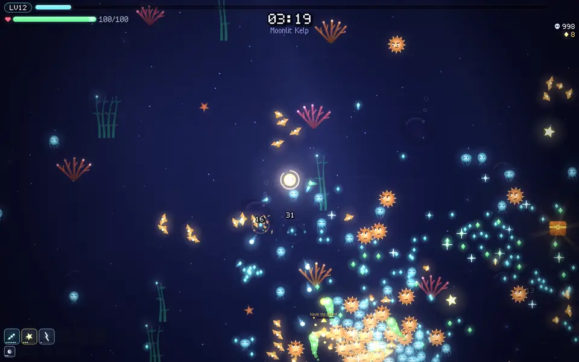</a><br><b><a href="https://ferravex.com/examples/glowtide/">Glowtide</a></b> · 2D<br><sub>Bioluminescent roguelite: evolving weapons, four spirits and a tide to survive</sub></td>
<td width="33%" valign="top"><a href="https://ferravex.com/examples/picnic-panic/">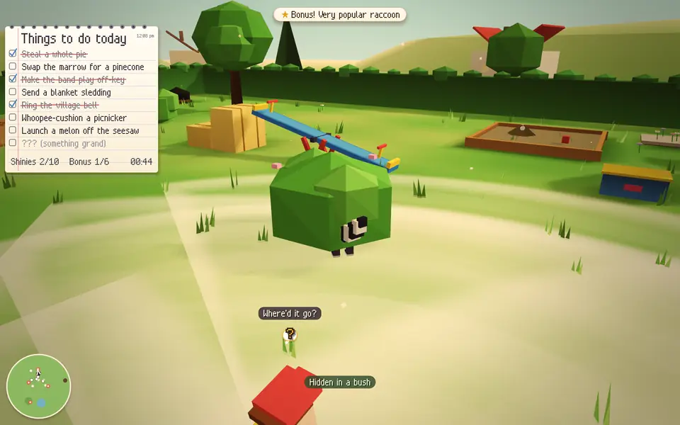</a><br><b><a href="https://ferravex.com/examples/picnic-panic/">Picnic Panic</a></b> · 3D<br><sub>A raccoon&#x27;s to-do list of pranks at the village picnic: sneak, steal, hide and launch the melon</sub></td>
<td width="33%" valign="top"><a href="https://ferravex.com/examples/mini-golf-2d/">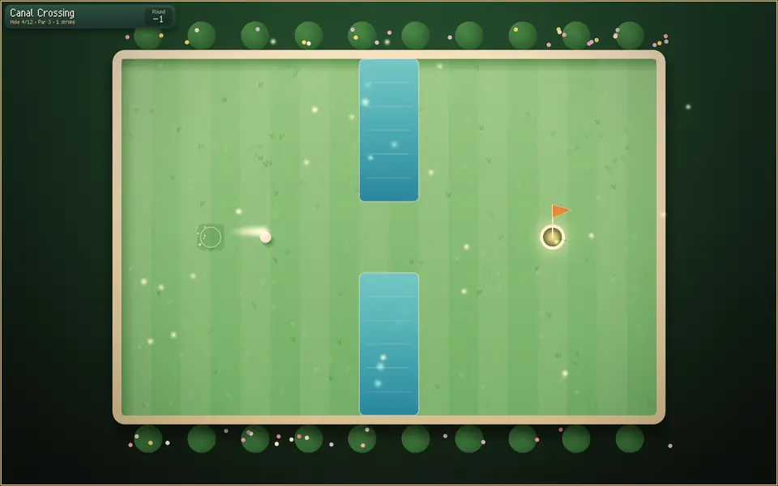</a><br><b><a href="https://ferravex.com/examples/mini-golf-2d/">Copper Greens 2D</a></b> · 2D<br><sub>Twelve holes of top-down mini golf: bank shots, lip-outs, ace confetti</sub></td>
</tr>
<tr>
<td width="33%" valign="top"><a href="https://ferravex.com/examples/mini-golf-3d/">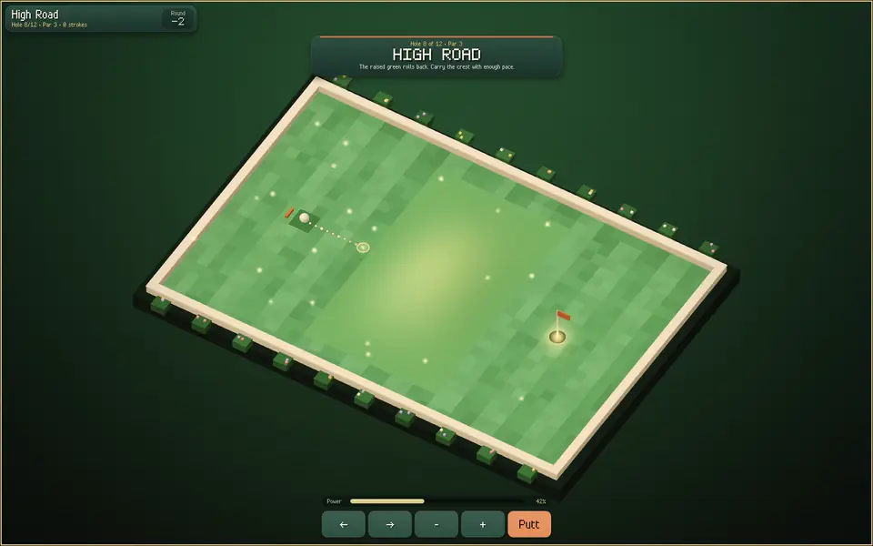</a><br><b><a href="https://ferravex.com/examples/mini-golf-3d/">Copper Greens 3D</a></b> · 3D<br><sub>The same course on raised greens with moving copper gates</sub></td>
<td width="33%" valign="top"><a href="https://ferravex.com/examples/emberline/">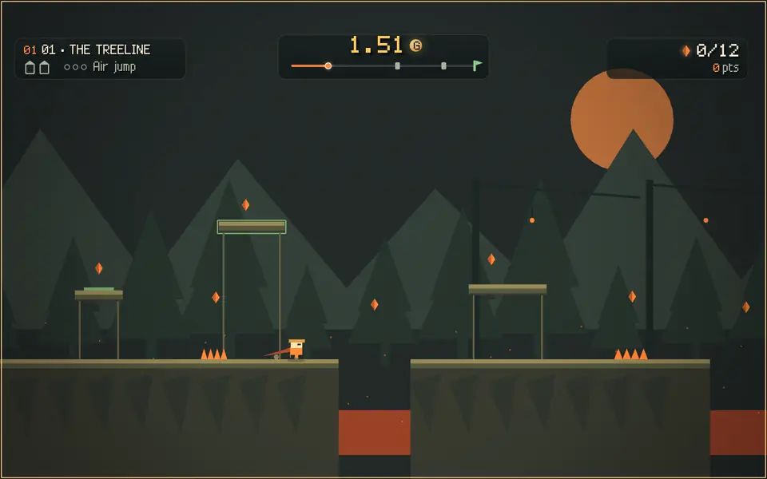</a><br><b><a href="https://ferravex.com/examples/emberline/">Emberline</a></b> · 2D<br><sub>Precision platformer with lanterns, medals and a secret moth</sub></td>
<td width="33%" valign="top"><a href="https://ferravex.com/examples/neon-swarm/">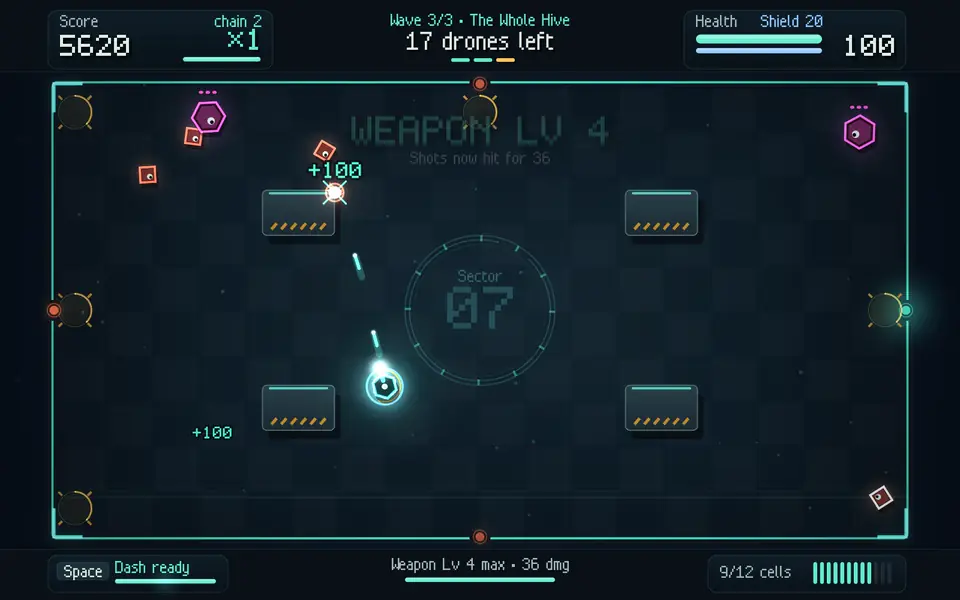</a><br><b><a href="https://ferravex.com/examples/neon-swarm/">Neon Swarm</a></b> · 2D<br><sub>Arena shooter: chain kills, dash, topple the Overseer</sub></td>
</tr>
<tr>
<td width="33%" valign="top"><a href="https://ferravex.com/examples/pocket-rally/">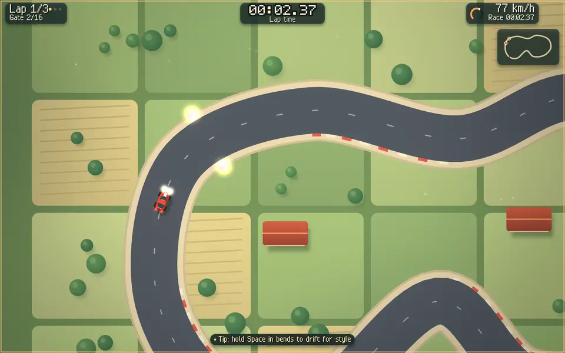</a><br><b><a href="https://ferravex.com/examples/pocket-rally/">Pocket Rally</a></b> · 2D<br><sub>Top-down rally: drift scoring, ghost splits, unhappy ducks</sub></td>
<td width="33%" valign="top"><a href="https://ferravex.com/examples/salvage-pinball/">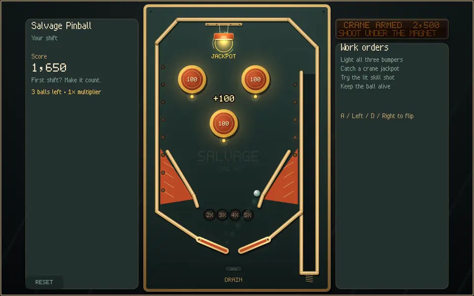</a><br><b><a href="https://ferravex.com/examples/salvage-pinball/">Salvage Pinball</a></b> · 2D<br><sub>Pinball with a magnet-crane jackpot and a grumpy foreman</sub></td>
<td width="33%" valign="top"><a href="https://ferravex.com/examples/orchard-guard/">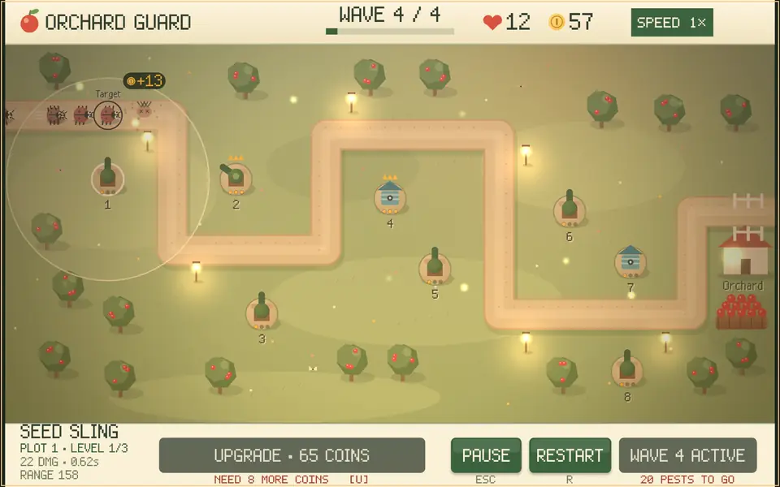</a><br><b><a href="https://ferravex.com/examples/orchard-guard/">Orchard Guard</a></b> · 2D<br><sub>Tower defense against googly-eyed beetles (and royalty)</sub></td>
</tr>
<tr>
<td width="33%" valign="top"><a href="https://ferravex.com/examples/owned-orbit/">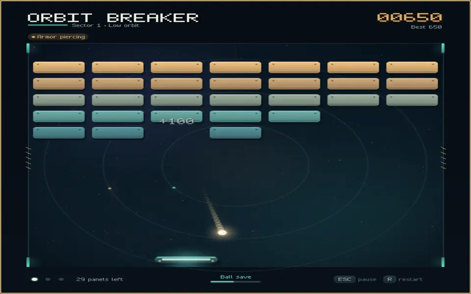</a><br><b><a href="https://ferravex.com/examples/owned-orbit/">Orbit Breaker</a></b> · 2D<br><sub>Brick breaker with multi-ball, sticky paddles and volley combos</sub></td>
<td width="33%" valign="top"><a href="https://ferravex.com/examples/marble-run/">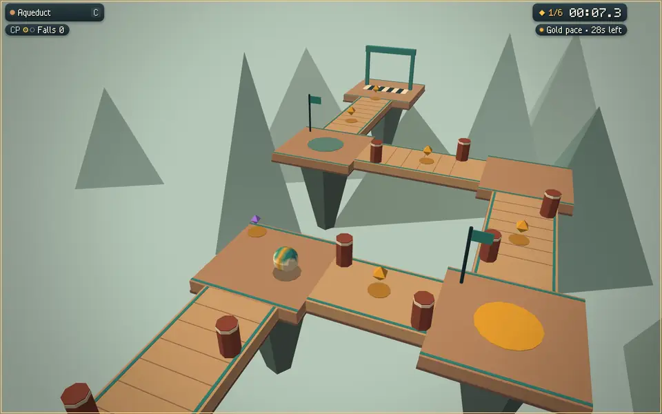</a><br><b><a href="https://ferravex.com/examples/marble-run/">Marble Run</a></b> · 3D<br><sub>Four sky courses, medal clocks and hidden moonstones</sub></td>
<td width="33%" valign="top"><a href="https://ferravex.com/examples/dune-skimmer/">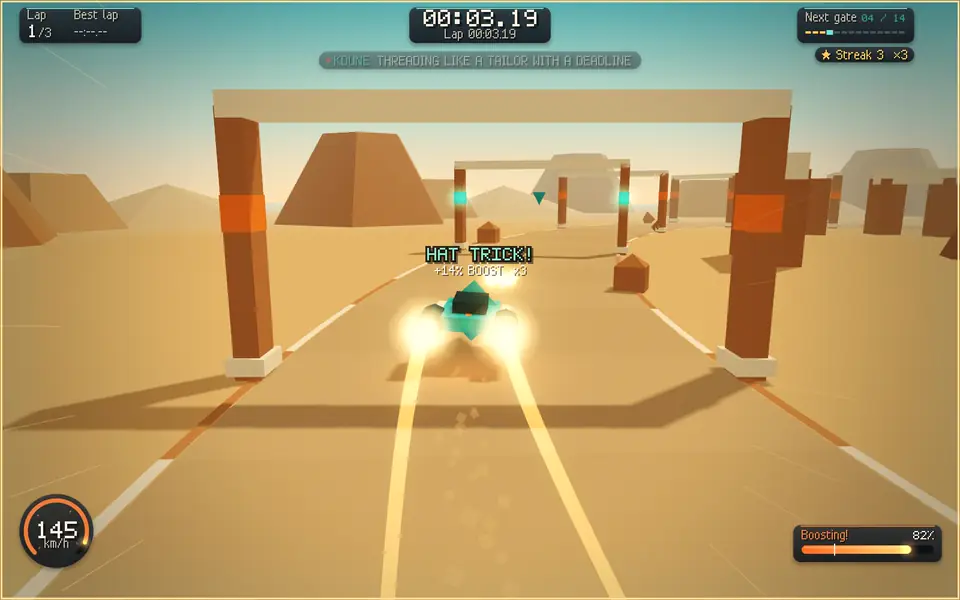</a><br><b><a href="https://ferravex.com/examples/dune-skimmer/">Dune Skimmer</a></b> · 3D<br><sub>Hover racing: thread gates for boost, beat Dusty the demo bot</sub></td>
</tr>
<tr>
<td width="33%" valign="top"><a href="https://ferravex.com/examples/crystal-cavern/">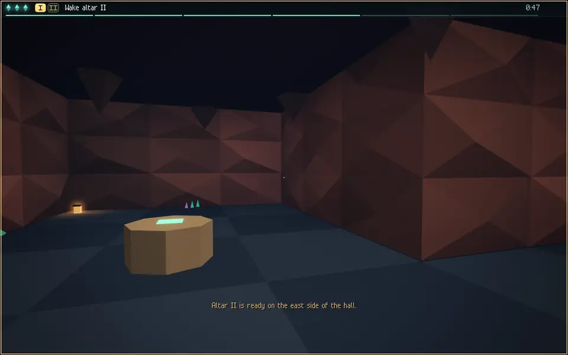</a><br><b><a href="https://ferravex.com/examples/crystal-cavern/">Crystal Cavern</a></b> · 3D<br><sub>First-person crystal hunt in a sarcastic cave</sub></td>
<td width="33%" valign="top"><a href="https://ferravex.com/examples/siege-foundry/">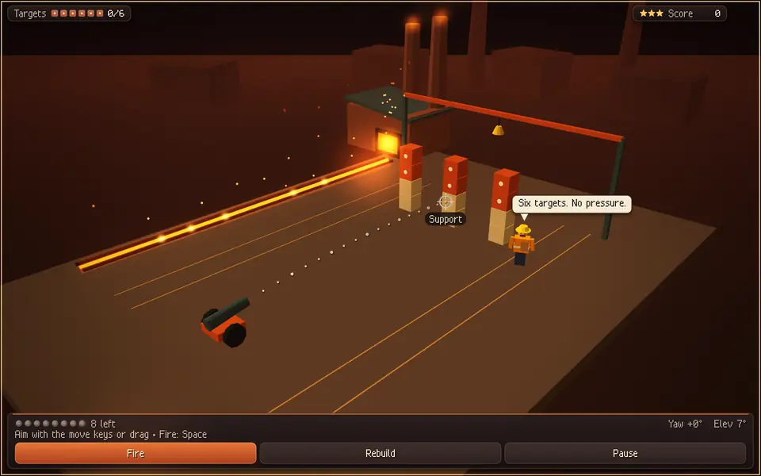</a><br><b><a href="https://ferravex.com/examples/siege-foundry/">Siege Foundry</a></b> · 3D<br><sub>Cannon demolition with chain collapses and three-star runs</sub></td>
<td width="33%" valign="top"><a href="https://ferravex.com/examples/sky-courier/">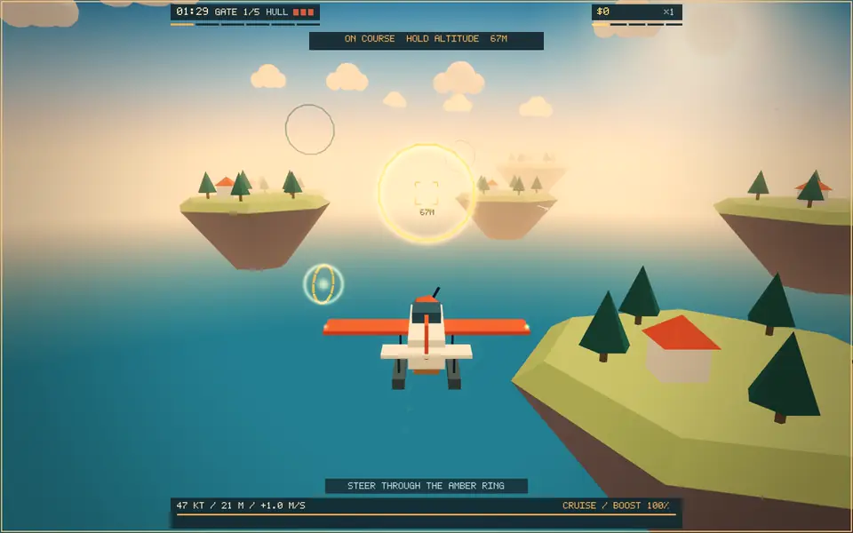</a><br><b><a href="https://ferravex.com/examples/sky-courier/">Sky Courier</a></b> · 3D<br><sub>Flight deliveries with tip streaks and golden rings</sub></td>
</tr>
<tr>
<td width="33%" valign="top"><a href="https://ferravex.com/examples/owned-lab/">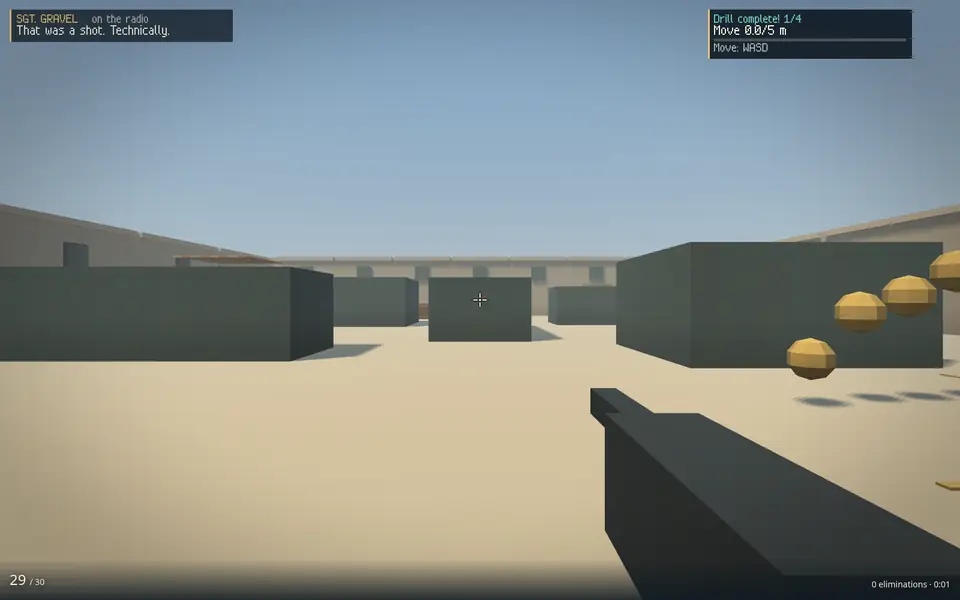</a><br><b><a href="https://ferravex.com/examples/owned-lab/">Courtyard</a></b> · 3D<br><sub>FPS drills, a 30-second graded qualifier and browser peer sessions</sub></td>
<td width="33%" valign="top"><a href="https://ferravex.com/examples/strike/">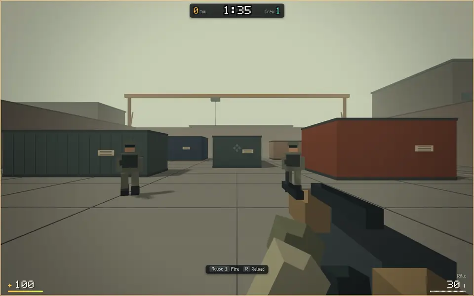</a><br><b><a href="https://ferravex.com/examples/strike/">Strike</a></b> · 3D<br><sub>Two-minute practice gauntlet vs. chatty bots; native UDP multiplayer</sub></td>
<td width="33%" valign="top"><a href="https://ferravex.com/examples/physics-2d/">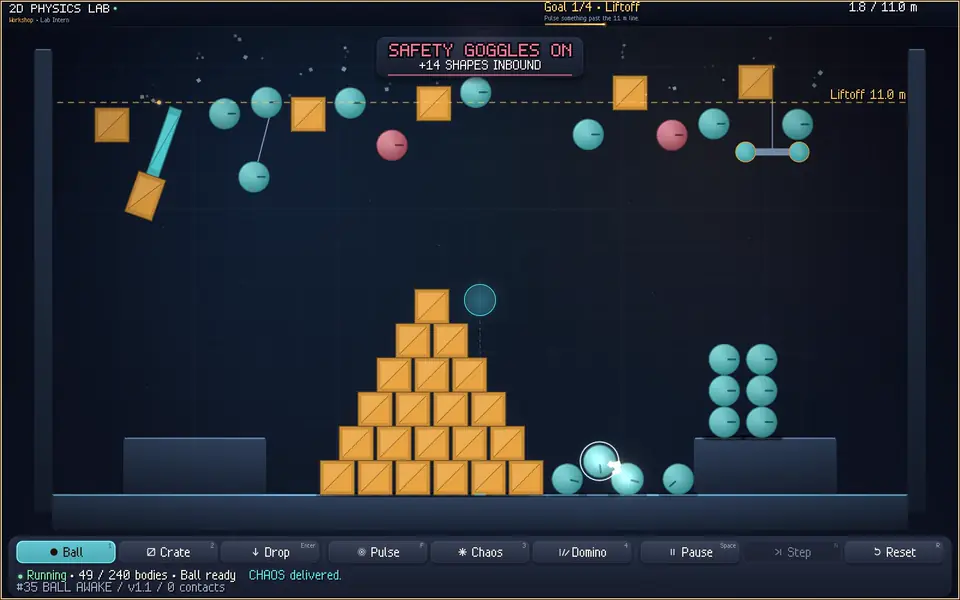</a><br><b><a href="https://ferravex.com/examples/physics-2d/">2D Physics Lab</a></b> · 2D<br><sub>Physics workshop: CHAOS, a domino run and optional goals</sub></td>
</tr>
<tr>
<td width="33%" valign="top"><a href="https://ferravex.com/examples/physics-3d/">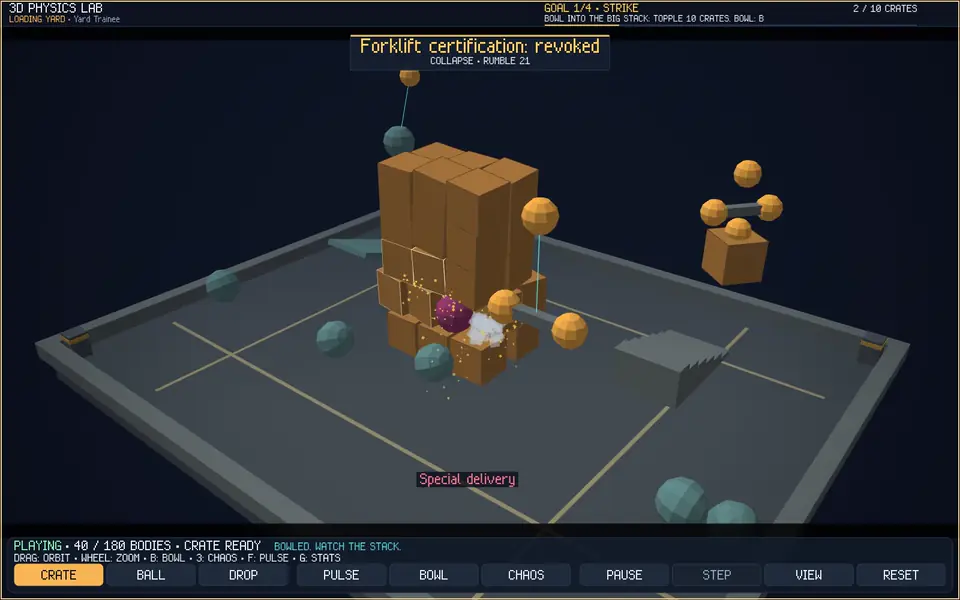</a><br><b><a href="https://ferravex.com/examples/physics-3d/">3D Physics Lab</a></b> · 3D<br><sub>Bowl into a 30-crate stack, drop CHAOS piles, earn titles</sub></td>
</tr>
</table>

The [catalog](examples/catalog.json) is the source of truth for IDs, controls and
hosts. Seventeen games use the shared `ferravex-render` runtime; Courtyard keeps its
instanced WebGL2 renderer and Orbit Breaker presents its Rust framebuffer through
Canvas2D. The [player guide](docs/PLAYER_GUIDE.md) covers the controls, settings,
accessibility options and troubleshooting tools every game shares.
See the [modernization notes](docs/MODERNIZATION_2026.md) for the new rendering
tools, Glowtide and verification limits.

## Play locally

You need Rust 1.88 or newer and Python 3.11 or newer (Node 22 or newer only for
host tests). From the checkout:

```sh
python3 -B scripts/ferravex.py doctor --profile web
python3 -B scripts/audit-owned.py
python3 -B scripts/ferravex.py test -p ferravex-core session
rustup target add wasm32-unknown-unknown
python3 -B scripts/ferravex.py build-web release --jobs 2
python3 -B scripts/serve-web.py --bind 127.0.0.1 --port 8000
```

Open http://127.0.0.1:8000/ for the local catalog. Each game has its own route,
such as `/mini-golf-2d/`, `/emberline/` or `/strike/`; Courtyard is `/owned/` and
Orbit Breaker is `/owned-orbit/`. Browser hosts use standard APIs directly, with
no external runtime libraries, fonts, art downloads or CDN loaders.

`ferravex.py list` lists catalog IDs and `--dry-run` previews any command. The
CLI uses offline, locked Cargo commands with at most two jobs. Scope `test` and
`check` with `-p`; otherwise they select the whole workspace. Doctor checks
prerequisites, not gameplay or device support.

## Native games and tools

Native games use first-party window and GPU bindings. Linux uses X11/GLX and needs
a working display and OpenGL 3.3 driver; Windows and Apple host source and its
verification status are described in [Platforms](docs/PLATFORMS.md):

```sh
python3 -B scripts/ferravex.py run neon-swarm
python3 -B scripts/ferravex.py run marble-run
python3 -B scripts/ferravex.py run strike
```

Courtyard and Orbit Breaker also run headless and can export PNG frames:

```sh
cargo run --release -p owned-lab --offline --locked -j 2 -- --frames 640 --output target/courtyard.png
cargo run --release -p owned-orbit --offline --locked -j 2 -- --autoplay --frames 1800 --screenshot target/orbit.png
cargo run --release -p ferravex-bench --offline --locked -j 2 -- 4096
cargo run --release -p ferravex-fps --bin ferravex-server --offline --locked -j 2 -- --bind 127.0.0.1:4000
```

The UDP server is for trusted development and LAN experiments. Courtyard has a
separate browser WebRTC host/guest adapter with manual offer/answer pairing and
no relay or account service. Browser and native network transports do not
interoperate automatically. See the [netcode API](crates/ferravex-fps/README.md).

## Make your own game

The [getting-started guide](website/content/getting-started.md) walks through
setup and the 2D/3D project generator. From this checkout, create a new sibling
project (the destination must not exist):

```sh
python3 -B scripts/ferravex.py new moon-garden ../moon-garden --template 2d --tick-rate 120 --window-title 'Moon Garden'
cd ../moon-garden
cargo test --offline --locked --jobs 2
```

Use `--template 3d` for a 3D view. The generator seeds a separate workspace and
lockfile and records provenance in `ferravex.json`. Follow its README for native
rendering and its own `target/web` browser build. To use the facade in an
existing project, add this manifest excerpt, adjusting the local path:

```toml
[dependencies]
ferravex = { path = "../ferravex/crates/ferravex" }
```

Start with `use ferravex::prelude::*;` for shared math, input and session types,
then use `render::` for drawing and host functions. The
[facade quickstart](docs/QUICKSTART.md) and its
[source](crates/ferravex/examples/quickstart.rs) show fixed updates, interpolated
rendering, pause and restart with this single dependency:

```sh
cargo run -p ferravex --example quickstart --offline --locked -j 2
```

That command opens a window and needs a working native graphics host. Append
`-- --headless` to run its fixed-tick, paused-step and restart assertions without
one. [Your first simulation](website/content/first-game.md) is a complete
headless program with executable assertions. `GameSession` coordinates local
start, pause, retry and fixed timing; `ferravex::core::session::SessionConfig::try_new`
checks settings before `GameSession::from_config` creates a session. For a
host-driven application, `ferravex::app` provides explicit startup, fixed-update,
render and shutdown hooks.

[Gameplay recipes](docs/GAMEPLAY_RECIPES.md) map reusable reward, weapon,
encounter, interaction, platform and trial rules to their host contracts. Run
`cargo run -p ferravex-play --example gameplay_recipe --offline --locked -j 2` for
a small survival/crafting composition.

## Documentation

- **Start here:** [Getting started](website/content/getting-started.md),
  [quickstart](docs/QUICKSTART.md), [tour the engine](docs/ENGINE_WORKFLOWS.md) and
  [design for different screens](docs/RESPONSIVE_GAMES.md).
- **Recipes:** [gameplay composition](docs/JOURNEY_200_GAMEPLAY.md),
  [HUD and presentation](docs/JOURNEY_200_PRESENTATION.md),
  [save and replay debugging](docs/JOURNEY_200_DEBUGGING.md),
  [performance measurement](docs/JOURNEY_200_PERFORMANCE.md),
  [accessible gameplay](docs/JOURNEY_200_ACCESSIBILITY.md),
  [template verification](docs/JOURNEY_200_TEMPLATES.md) and the
  [API migration cookbook](docs/MIGRATION_200.md).
- **How it fits together:** [architecture](docs/ARCHITECTURE.md),
  [implementation map](docs/FROM_SCRATCH.md), [validation guide](docs/GAME_TESTS.md)
  and [platform status](docs/PLATFORMS.md).

The facade exposes timing, entities, math, ECS, translational dynamics, software
graphics, gameplay, input, audio, assets, profiling, replay and networking. The
games depend directly on the immediate renderer and, where needed,
`ferravex-physics` for rotational rigid bodies. There are no optional external
renderer or physics backends.

## Status and limits

This is an engine foundation with original native and browser hosts, shared GPU
rendering, audio and development/LAN multiplayer. Internet services and a Metal
backend are future work. Historical Windows/macOS cross-target results do not
verify the current revision; runtime/SDK linking and device validation have their
own limits, recorded in [Platforms](docs/PLATFORMS.md). The
[release scope](docs/STOPPING_POINT.md) separates shipped work from deferred plans.

## Contributing

Read [CONTRIBUTING.md](CONTRIBUTING.md). Coding agents should also read
[AGENTS.md](AGENTS.md) and the [coding-agent guide](docs/AGENT_GUIDE.md) for the
repository map and development workflow. Planning ledgers record how the engine
got here: the [Journey50 roadmap](docs/JOURNEY_50.md) and
[results](docs/JOURNEY_50_RESULTS.md), the [Journey200 ledger](docs/JOURNEY_200.md)
and the [Journey400 roadmap](docs/JOURNEY_400.md). Implementation receipts are
not final integration evidence.

Check documentation navigation without rebuilding artifacts:

```sh
python3 -B scripts/build-site.py --check-sources
python3 -B scripts/build-site.py --self-test
```

For full integration after concurrent edits settle, the integration owner runs
broader checks and regenerates shared output:

```sh
cargo fmt --all -- --check
cargo test --workspace --all-features --offline --locked -j 2
cargo clippy --workspace --all-targets --all-features --offline --locked -j 2 -- -D warnings
cargo build --release --workspace --bins --offline --locked -j 2
python3 -B scripts/smoke-games.py --output target/game-smoke
node examples/owned-orbit/tests/platform-input.mjs
CARGO_BUILD_JOBS=2 python3 -B scripts/build-site.py
python3 -B scripts/test_audit_owned.py
python3 -B scripts/test_site.py
python3 -B scripts/serve-site.py --bind 127.0.0.1 --port 8080
```

The full native smoke run needs a Linux X display for the restored games. Use
`--game owned-lab --game owned-orbit` for only the headless hosts. Generated web
and site output lives in `dist`; these commands build and serve it locally.

## License

MIT. Engine and game source and authored assets are first-party. Build
toolchains, operating systems and browser implementations have their own licenses.
