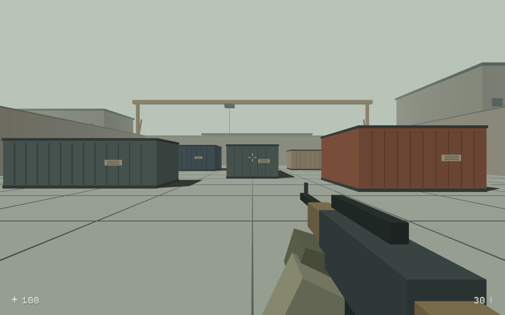

# Ferravex

[Website](https://ferravex.com) · [Documentation](https://ferravex.com/docs/getting-started/) · [Examples](https://ferravex.com/examples/) · [Rust API](https://ferravex.com/api/ferravex/index.html)

Ferravex is moving to an original Rust engine with **zero third-party runtime packages** in its default dependency graph. The first-party math, ECS, physics, renderer, gameplay systems, assets, audio, input, replay and netcode are implemented in this repository. Rust std and operating-system/browser APIs form the platform boundary.

```sh
python3 scripts/audit-owned.py
cargo test --workspace
python3 scripts/build-owned.py
python3 scripts/serve-web.py --port 8000
```

Open [Courtyard](http://127.0.0.1:8000/owned/) for the original low-poly FPS scene or [Orbit Breaker](http://127.0.0.1:8000/owned-orbit/) for the original 2D game. Courtyard has direct WebGL2 instancing, culling, shadows, spatial audio, shader reload, a position inspector, input recording, and browser peer sessions. Orbit exercises the owned 2D physics, input and VFX systems through Canvas2D. Native headless runs export PNGs.

```sh
cargo run --release -p owned-lab -- --output /tmp/courtyard.png
cargo run --release -p owned-orbit
```

The [twenty-feature implementation map](docs/FROM_SCRATCH.md) lists usable systems and remaining work. **This is not a finished competitive shooter, and external libraries have not yet been removed from every earlier example.** The legacy adapters below remain while those games are migrated. Native window/GPU/audio backends, complete rotational physics, secure native networking and device validation remain substantial work.

## Earlier examples and compatibility adapters

The following examples retain the earlier Macroquad renderer and optional Rapier physics. Their simulation/core now use the owned math and ECS.

A small, modular Rust game framework and an original low-poly tactical FPS prototype. The initial goal is a useful, measurable foundation for a compact Counter-Strike-style game: predictable simulation, portable rendering, optional physics, and server-owned game state.

**This is an initial framework, not a finished competitive shooter.** Linux and browser builds are exercised locally; Windows, macOS, and iOS have build paths and CI checks but require verification on those systems. Browser examples currently run offline; native clients have UDP multiplayer.



## Run

Install a current stable Rust toolchain, then:

```sh
cargo run --release -p strike
cargo run --release -p physics-2d
cargo run --release -p physics-3d
```

Strike opens a live view of **Dockyard**, an original industrial arena. Select **Play** or press Enter. WASD moves, mouse aims, left click fires, Space jumps, R reloads, Tab shows the roster, and Escape opens the menu. F3 toggles performance diagnostics; the default HUD shows only health, ammunition, and the crosshair. Five moving practice opponents use the same movement, collision, weapons, and health rules as network players. Touch controls are included for the FPS and physics demos; mobile device ergonomics remain to be tested.

The visual baseline is deliberately low-poly: flat face normals, muted material colors, directional light, atmospheric fog, authored silhouettes, and geometric details. Geometry is built once at startup. There are no downloaded art assets and no proprietary game content.

## Ten game examples

Open `http://127.0.0.1:8000/gallery.html` after the browser build, or run any package
with `cargo run --release -p <package>`. Each is a complete small gameplay loop
with restart and an automated player for testing; none downloads art assets.

| Game | Dimension | What it exercises |
| --- | --- | --- |
| [Emberline](examples/emberline) | 2D | Platform collision, jump buffering, checkpoints, collectibles |
| [Neon Swarm](examples/neon-swarm) | 2D | ECS, swept projectiles, enemy waves, pickups, dash |
| [Pocket Rally](examples/pocket-rally) | 2D | Driving, traction, ordered checkpoints, lap ghost |
| [Salvage Pinball](examples/salvage-pinball) | 2D | Rapier flippers, CCD, contact scoring, ball lifecycle |
| [Orchard Guard](examples/orchard-guard) | 2D | Tower placement, upgrades, targeting, waves, economy |
| [Marble Run](examples/marble-run) | 3D | Rapier rolling, checkpoint recovery, pickups |
| [Dune Skimmer](examples/dune-skimmer) | 3D | Hover racing, boost, ordered gates |
| [Crystal Cavern](examples/crystal-cavern) | 3D | Exploration, collision, interaction, puzzle progression |
| [Siege Foundry](examples/siege-foundry) | 3D | Projectile CCD, rigid-body destruction, scoring |
| [Sky Courier](examples/sky-courier) | 3D | Flight controls, delivery gates, obstacle collision |

The [catalog](examples/catalog.json) drives browser navigation, builds, and size
reports. Each game's README gives controls and gameplay tests. To capture a
repeatable native run (requires a graphics display):

```sh
cargo run --release -p neon-swarm -- --autoplay --smoke-frames 750 --screenshot /tmp/neon-swarm.png
cargo build --release --workspace --bins
python3 scripts/smoke-games.py
```

Smoke runs advance a fixed render timestep and report game state; their wall
times are not performance measurements. See [game validation](docs/GAME_TESTS.md)
for shared fixes, coverage, and platform limits.

## Multiplayer

In separate terminals:

```sh
cargo run --release -p ferravex-fps --bin ferravex-server -- --bind 127.0.0.1:4000
cargo run --release -p strike -- --connect 127.0.0.1:4000
cargo run --release -p strike -- --connect 127.0.0.1:4000
```

Use `--bind 0.0.0.0:4000` and the server's LAN address for another computer on the same network. Each client receives its own operator; up to 16 are supported. The 64 Hz server owns movement, hitscan, wall occlusion, damage, fire rate, ammunition, reloads, and respawns. Clients predict local movement, replay unacknowledged inputs, and interpolate remote players. Redundant input packets recover isolated loss, while bounded queues, validation, and a per-tick input budget limit network work.

This transport is for local development and trusted LAN play. It has session cookies and input validation, but no encryption, account authentication, matchmaking, or NAT traversal. Protocol v2 now replicates reliable gameplay events. Historical rewind is available through an opt-in authority API; wire timestamp integration remains pending. See [netcode details](docs/ARCHITECTURE.md#netcode) and [FPS implementation](crates/ferravex-fps/src/lib.rs). It is not production internet infrastructure.

## Browser

```sh
rustup target add wasm32-unknown-unknown
./scripts/build-web.sh release
python3 scripts/serve-web.py --port 8000
```

Open `http://127.0.0.1:8000`. The thirteen examples run as Rust WebAssembly with a locally bundled, version-matched loader. `./scripts/build-web.sh small` favors smaller downloads; it is a separate profile because smaller code can execute more slowly. Web multiplayer requires a browser transport adapter, planned separately from the existing UDP implementation.

Staging applies a checked, version-specific fix for Macroquad 0.4.16's strict-mode plugin registration error; the patch and loader hashes are recorded in `build-info.json`. See [the loader patch details](docs/PLATFORMS.md#web).

See [platform builds and verification status](docs/PLATFORMS.md) for Apple targets, packaging, and CI.

## Use the framework

Depend on the facade and select features per game:

```toml
[dependencies]
ferravex = { path = "crates/ferravex", default-features = false, features = ["render", "physics2d"] }
```

```rust
use ferravex::{FixedClock, World};
use ferravex::physics::d2::PhysicsWorld;

let mut entities = World::new();
let mut physics = PhysicsWorld::new([0.0, -9.81]);
let body = physics.add_box([0.0, 5.0], [0.5, 0.5], true);
entities.spawn((body,));
let mut clock = FixedClock::new(64.0, 8);

// In your platform frame loop:
let frame = clock.advance(1.0 / 60.0);
for _ in 0..frame.steps {
    physics.step(frame.dt);
}
// frame.alpha interpolates previous/current poses for rendering.
```

| Crate | Responsibility |
| --- | --- |
| `ferravex` | Feature-gated public facade |
| `ferravex-core` | Fixed ticks, bounded catch-up, frame statistics, owned sparse ECS, swept 2D collision queries |
| `ferravex-render` | Portable graphics/input, flat-shaded primitive meshes, GLSL/MSL materials, DPI-safe 2D canvas, example runner |
| `ferravex-physics` | Independently optional Rapier 2D and 3D, bodies, joints, CCD, raycasts, full underlying API |
| `ferravex-net` | Transport-independent bounded binary codec, input queues, native UDP primitives |
| `ferravex-fps` | Shared shooter simulation, prediction/reconciliation, native client and headless server |
| `ferravex-bench` | Repeatable simulation and physics baseline |

The renderer uses [Macroquad/Miniquad](https://github.com/not-fl3/macroquad) for its small dependency footprint and desktop, iOS, and web backends. This first renderer targets portable stylized graphics; compute shaders, PBR, shadow maps, and a retained GPU scene backend are absent from this legacy adapter; the owned browser host implements shadows and retained instanced meshes. [Rapier](https://rapier.rs/docs/user_guides/rust/getting_started/) supplies mature general-purpose physics rather than a new solver. The FPS intentionally uses a small shared static-world character solver for predictable authority and a smaller shipped client. Dynamic Rapier bodies are demonstrated separately; they are not yet synchronized by netcode.

Shaders live in [ferravex-render/src/shaders.rs](crates/ferravex-render/src/shaders.rs). `load_shader` accepts paired GLSL and Metal sources, custom uniforms, and pipeline settings. Shader compilation returns an error; the 3D examples provide an unlit fallback. See [rendering API](crates/ferravex-render/src/lib.rs).

## Measure and verify

```sh
cargo test --workspace
cargo fmt --all -- --check
cargo clippy --workspace --all-targets -- -D warnings
cargo run --release -p ferravex-bench -- 4096
cargo build --release -p strike -p ferravex-fps
python3 scripts/report-size.py
```

The benchmark warms each workload and reports mean, p50, and p99 tick time for 16 FPS actors, 256 awake 2D bodies, and 256 awake 3D bodies. It excludes rendering and network transport. The F3 diagnostics overlay shows real rolling frame times and scene triangle counts. See [recorded baseline](docs/PERFORMANCE.md) for this machine's results and their limits. No claim is made that Ferravex is the fastest or smallest engine.

Release uses optimization level 3, thin LTO, one codegen unit, symbol stripping, and abort-on-panic. The `small` profile uses size optimization and fat LTO. Physics and rendering are separate dependencies, so the server does not link GPU/window code and Strike does not link both physics dimensions.

## Direction

The owned gameplay crate supplies tactical round/economy rules; integrating them into the playable shooter remains a milestone. Before public multiplayer: server rewind for hitscan, time synchronization, congestion control, transport security, and packet-loss testing under real latency. Before platform releases: Apple/Windows runtime checks, touch/gamepad refinement, audio, and packaging. The [architecture and roadmap](docs/ARCHITECTURE.md) distinguish implemented systems from planned work.

MIT licensed. Third-party libraries retain their own licenses; Cargo.lock pins the resolved dependency graph.
