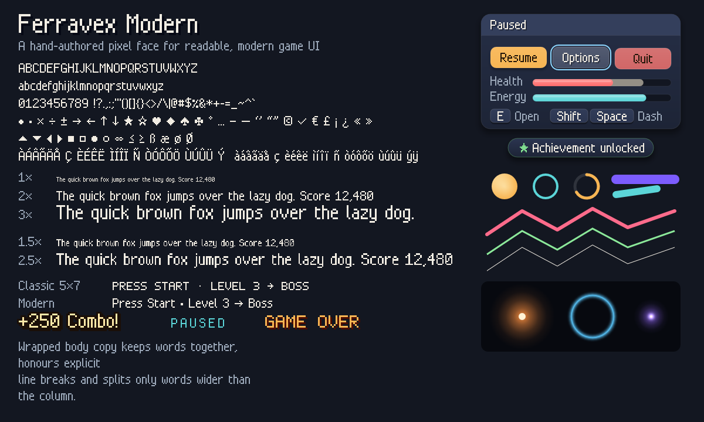

# Shared HUD and menus

`ferravex_render::ui::Ui` renders compact screen-space overlays on the same
native OpenGL and browser WebGL2 stream as the world. It queues solid/gradient panels, bitmap
text and buttons, applies nested rectangular clips, and preserves paint order.
It does not change the caller's camera, lighting, material, depth or shader state.
Strike uses it for labels, diagnostics, roster and Play/Resume; Neon Swarm uses
it for its HUD and Start/Resume/Restart menus; Orchard Guard uses it for build,
upgrade, wave and restart buttons. Existing immediate helpers remain compatible.

```rust
use ferravex_render::ui::{Ui, UiRect, Viewport, TextStyle, ButtonStyle};
let mut ui = Ui::new(); // Keep this instance across frames.
let viewport = Viewport::fit([1280., 720.], [1280., 720.], [0.; 4]).unwrap();
ui.begin(viewport);
ui.text_fmt(UiRect { min: [24., 20.], size: [220., 24.] },
    TextStyle::default(), format_args!("Health {}", 100)).unwrap();
ui.button(1, UiRect { min: [24., 60.], size: [180., 44.] },
    "Resume", true, ButtonStyle::default()).unwrap();
ui.finish(true); // Layout first, then process the current input journal once.
ui.paint();
if ui.activated(1) { /* resume */ }
```

Use logical display pixels, not framebuffer/device pixels. `Viewport::fit`
letterboxes a design size inside the available screen, with left/top/right/bottom
safe-area insets. The caller supplies OS safe areas; automatic mobile insets
remain a native-host concern. `unproject` rejects letterbox space and half-open
outer edges. Renderer-independent `Anchors` and `slots` support anchored/stretch
rectangles and allocation-free equal row/column layouts. Neon and Orchard share
their existing design-space viewport with world rendering; Strike keeps its
responsive screen-space HUD.

Stable numeric IDs preserve capture and focus across frame rebuilds. Tab/right/
down advance focus; Shift+Tab/left/up go backward; Enter activates. Selected-pad
D-pad/A uses `finish_with_gamepad(enabled, player.settings().gamepad)`.
`finish_player(&mut player, enabled)` also accepts the profile’s remapped global
confirm action; the three adopting games use this adapter. Gameplay overlays can
`set_auto_focus(false)` to require an explicit focus choice before accepting, so
Orchard’s A button can still select a plot until its HUD receives focus. Navigation
is edge based, without held-key repeat. Hotplugged held A is suppressed for the
connection frame. Event-time mouse positions preserve fast same-frame drag cancellation.
Mouse and touch require press and release on the same enabled,
visible widget. One pointer owns capture; another mouse/finger cannot steal or release it. Removed,
disabled, fully clipped, cancelled, unfocused or overflowed input cancels capture.
Disabled widgets occlude clicks underneath. The F2 controls editor blocks menu
input. Navigation and Enter have fixed host bindings in addition to a profile’s
remapped confirm action. Gameplay action rebinding remains in PlayerInput. Space remains available to games such as Orchard's wave shortcut.

Call `modal(blocker_id)` before adding modal buttons to remove lower controls
from interaction. Add its covering panel after lower draw commands. IDs must
be unique within the current interaction scope, including the blocker. A
nonfocusable blocker absorbs outside presses without activating another button.
Rebuild/finish/paint a UI once per render frame. Keep game actions behind an
appropriate input context; UI is not a simulation scheduler.

The original 5×7 font is drawn as horizontal bit runs, reducing geometry compared
with one rectangle per lit pixel. Text supports alignment, shrinking to fit,
explicit newlines, character wrapping, clipping and an optional shadow. UTF-8
boundaries are preserved; unsupported characters render `?`. It does not provide
complex-script shaping, rich text, editable fields, localization or a screen-reader
bridge. The browser's DOM Controls/Sound buttons expose their state, but the canvas F2
editor does not yet expose its internal fields to screen readers.

Each Ui preallocates 1024 commands/widgets and a 32 KiB text arena. A frame admits
at most 196608 estimated vertices and 16 clip levels; oversized or invalid commands
return UiError without partially registering a button or retaining formatted text.
`text_fmt` writes directly into the arena. Actual glyph geometry is clipped before
submission. Renderer stream buffers may grow on initial/worst-case use; reused
UI buffers do not grow during a frame. Each Ui owns 213504 bytes (about 209 KiB) of command,
text and widget capacity on this 64-bit host, in addition to the renderer stream.
Use fewer instances rather than one instance per entity. No textures, external
fonts, layout libraries or third-party packages are required.

## Current layout and composition APIs

Use `Viewport::responsive` to author a HUD in logical screen pixels without
scaling its fonts with the world. `HudRegions` reserves strips around a fitted
scene; `ui::flow` wraps measured actions into complete rows. The renderer adds
wrapped-text blocks, responsive stat lists, continuous/segmented meters and
content-driven `CardLayout` menus. These helpers return overflow or omissions
explicitly; keep a visible paging or scroll path for content that cannot fit.

`Ui::compose` builds an atomic widget group with rollback on composition errors.
`Ui::interaction` reports pointer ownership through release/cancellation, so a
world editor can avoid placing a body behind a button. Opt-in `Ui::inspect` and
caller-buffer export describe the widgets actually registered this frame.

Themes, UI preference adapters and the semantic status bridge are opt-in.
A host can expose declared labels/status through a DOM adapter, but arbitrary
canvas text does not automatically become a screen-reader interface. Use the
[responsive-screen guide](RESPONSIVE_GAMES.md) and
[current workflows](ENGINE_WORKFLOWS.md#keep-the-hud-readable) for a small runnable
layout and the correct world/HUD/input boundaries.

## Modern UI kit



Every piece below is opt-in and additive. The legacy font, `draw_text_ex` and
`Ui` paint emit exactly the same geometry as before (`draw_text_ex` keeps one
quad per lit pixel because browser tests count those quads; it now records them
with one stream borrow per string). Drawing the same classic letters through
`draw_text_styled` with `FontFace::Classic` uses about 64% fewer vertices on a
text-heavy HUD (10,038 → 3,588 vertices for ten typical HUD lines); the modern
face is similar (3,780).

**Text** — `ferravex_render::text`. `FontFace::Modern` is a hand-authored,
mixed-case, proportional pixel face: 8-pixel capitals, 6-pixel x-height,
2-pixel descenders, tabular 5-pixel digits, kerning for awkward pairs (`To`,
`LT`, `r.`), punctuation, UI symbols (`• · × → ← ↑ ↓ ★ ♥ ♦ ♠ ♣ … ✓ ▲ ▶ ●`) and
Latin-1 accents. `FontFace::Classic` draws the original 5×7 letters through the
same API. As with the legacy face, one font pixel is `size / 8`, so sizes that
are multiples of 8 stay crisp, and `y` is the baseline.

```rust
// Excerpt: `button_center_y` is a caller value. Rustdoc examples are runnable.
use ferravex_render::{Color, text::{TextAlign, TextStyle, draw_text_styled, draw_text_wrapped, measure_text_styled}};
let hud = TextStyle::modern(16., Color::from_hex(0xf2ede3))
    .with_shadow(Color::new(0., 0., 0., 0.55));            // 1 font-pixel drop shadow
let title = TextStyle::modern(32., Color::from_hex(0xffe9a8))
    .with_outline(Color::from_hex(0x1a0f08))                // 1 font-pixel outline
    .with_align(TextAlign::Center);
draw_text_styled("Score 12,480 ★", 24., 40., hud);
draw_text_styled("Level complete!", 640., 120., title);
let size = measure_text_styled("Level complete!", title);   // same advances as drawing
draw_text_wrapped("Collect every gem before the lava rises.", 24., 200., 280., hud);
let centered = hud.centered_baseline(button_center_y);       // optical centering on caps
```

`measure_text_styled`, `text_width` and the allocation-free `wrap_text`
iterator use exactly the advances that drawing uses. Text geometry merges each
glyph's identical row runs into rectangles (stems become one quad); outlines
merge across neighbouring glyphs so translucent outlines never double-blend.

**Shapes** — `ferravex_render::shapes`. Anti-aliased by a one-device-pixel
transparent fringe (no textures or shader changes), written straight into the
frame's vertex stream with no allocation: `fill_rounded_rect`,
`stroke_rounded_rect`, `fill_circle`, `stroke_circle`, `stroke_arc` (meters and
cooldowns), `fill_capsule`, `polyline` (miter/bevel/round joins, butt/square/round
caps), `drop_shadow` (smoothstep falloff), and additive `glow_disc`/`glow_ring`
for particles. Fills accept `Fill::Solid`, `Fill::linear`/`vertical`/`horizontal`
and `Fill::radial` gradients evaluated per vertex. Each function documents its
maximum vertex count (for example 612 for a filled rounded rectangle).

**Motion** — `ferravex_play::tween`. `Ease` (linear, sine, quad, cubic, quart,
expo, back, elastic and bounce, each in/out/in-out, with exact endpoints),
`Tween`, analytic `Spring` (critical, underdamped, overdamped), staggered
`Entrance` (fade/slide/scale), `RollCounter` for score roll-ups and
`ScreenTransition` (fade, wipe, iris with cover → swap → reveal events). All are
`Copy`, advanced by a caller `dt` and take a `Motion` argument; pass
`Motion::from(feedback_policy)` so reduced motion snaps tweens/springs, keeps
fades without movement and turns wipes/irises into fades.

**Kit** — `ferravex_render::ui::kit`, visual only: `panel`, `card` (header
band), `button` with `ButtonMotion` eased hover/press/focus, `meter` with a
trailing "ghost" value, `toast`, `keycap`/`key_prompt` and
`draw_screen_transition`. Keep input in `Ui`: submit buttons with
`kit::INVISIBLE_BUTTON`, then paint with `kit::ui_button_state(&ui, id, enabled)`
and `kit::ui_rect(ui.viewport(), rect)`. `KitTheme::from_ui_theme` adopts a
contrast-checked `UiTheme` palette (including high contrast).

```rust
// Excerpt: `feedback_policy`, `menu_time`, `card_rect`, `ui`, `RESUME`,
// `resume_rect`, `resume_motion` and `dt` come from the game.
use ferravex_play::tween::{Entrance, Motion};
use ferravex_render::ui::kit::{self, ButtonKind, KitTheme};
let theme = KitTheme::default();
let motion = Motion::from(feedback_policy);
let look = Entrance::fade_up(12.).sample(menu_time, 0, motion);
let inner = kit::card(kit::appear(card_rect, look), Some("Paused"), &theme.faded(look.alpha));
resume_motion.update(kit::ui_button_state(&ui, RESUME, true), dt, motion);
kit::button(kit::ui_rect(ui.viewport(), resume_rect), "Resume", ButtonKind::Primary, &resume_motion, &theme);
```

Recommended style: spacing `kit::SPACE` = 4, 8, 12, 16, 24, 32; radii 6 (chips,
key caps), 10 (buttons, toasts), 16 (cards); modern type 8 caption, 16 body,
24 title, 32 display. Keep the retro identity by pairing the modern face for
copy with the classic face (or a game's own art) for big numerals and titles,
and by keeping colors flat with only a subtle top-lit gradient on surfaces.
Regenerate the specimen with
`FERRAVEX_SPECIMEN=/tmp/specimen.png cargo test -p ferravex-render --lib specimen`.
